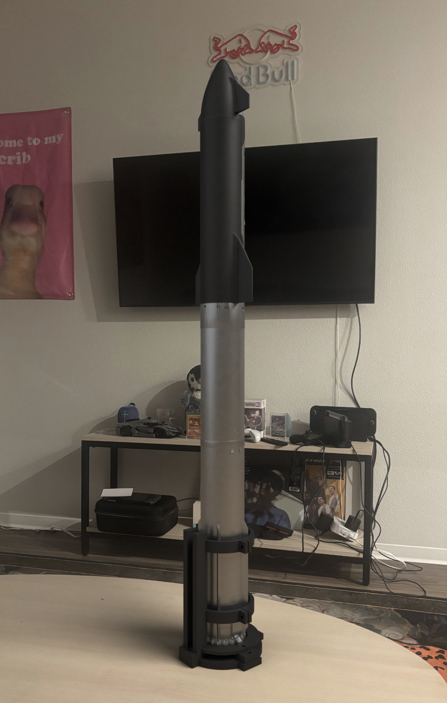

# Starship S24/B7

This is a 1:124-scale model of Starship S24/B7, the ship and booster that flew on Flight 1 in April 2023. It is about 96 cm (38 in) tall and is split into parts that fit a Markforged X7.

## Printing

The STL files in [model/](model/) are in millimeters. Move and orient each part on the build plate in Eiger. `joints/upper_seam_keys.stl` holds two keys; separate them before slicing.

Print in Onyx or a similar filament, starting from Eiger's Onyx settings. Continuous fiber is optional. Print one grid fin and the booster section it mounts on first to check the fit.

Print one of each file, except `booster/grid_fin` (4), `stand/leg` (4), `stand/front_clamp` (2), `stand/spacer` (3) and `joints/bored_key` (4).

Most ship parts and the covers come in two halves. Files ending in `black` are the heat-shield side and files ending in `metal` are the steel side. Paint the booster and the `metal` halves silver.

## Assembly

1. Stack the booster from the bottom: `base_and_engines`, `lower_top`, `upper_bottom`, `upper_top`, with a `bored_key` at each joint.
2. Fit the four grid fins to the top of the booster.
3. Join each black half to its metal half: `tank_bottom`, `tank_top`, `nose` and the four flaps.
4. Put the wires for the bottom flaps in before adding `tank_top`. The wires for the top flaps go through the base of the nose before the nose joins `tank_top`.
5. Dry-fit the ship tanks, nose, `engines_black` and `ship_booster_connector`, using the keys and covers at their matching seams.
6. Build the stand from the hub, four legs, rear post, two front clamps, two shelves and three spacers.
